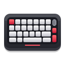
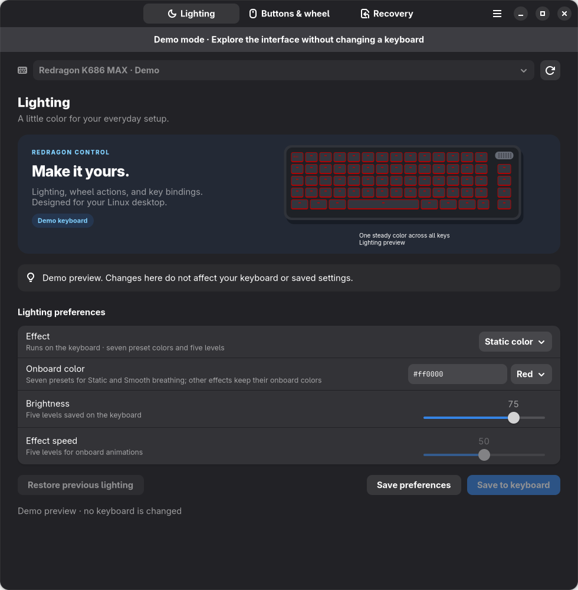
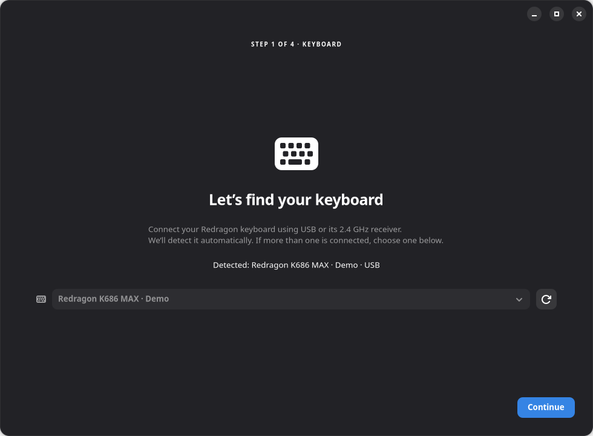
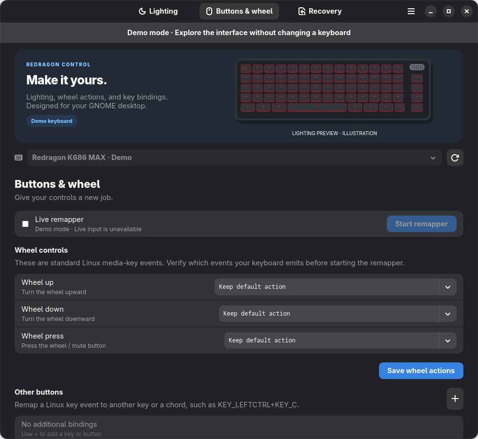
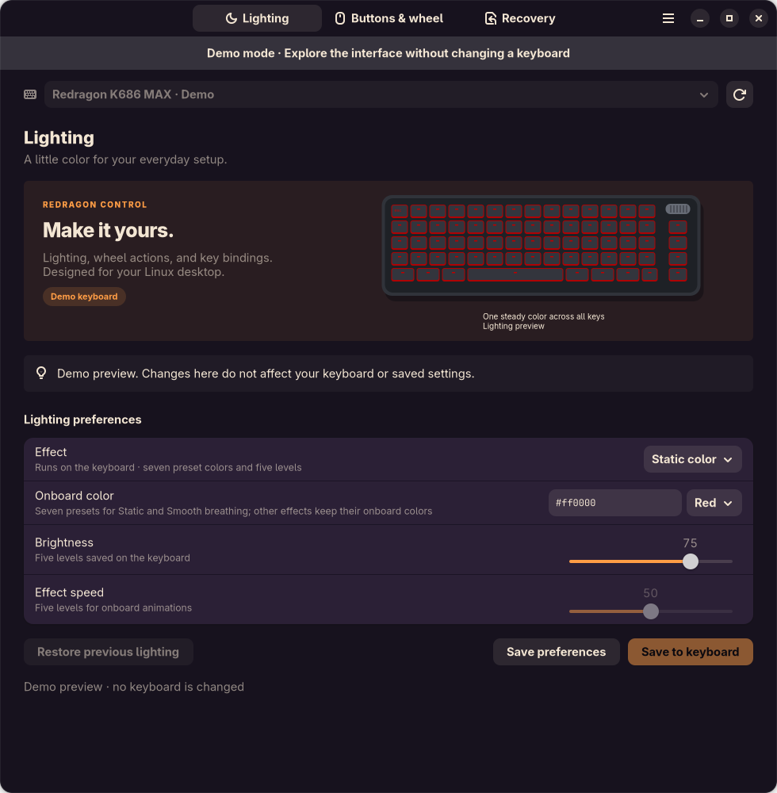

<p align="center">
  
</p>

<h1 align="center">Redragon Control</h1>

<p align="center">
  Lighting, key shortcuts, and wheel controls for your Redragon K686 MAX on Linux.
</p>

<p align="center">
  <a href="https://github.com/wfoyt/Redragon-Control/releases/latest">Download</a> ·
  <a href="#installation">Installation</a> ·
  <a href="#features">Features</a> ·
  <a href="#getting-started">Getting started</a> ·
  <a href="docs/advanced.md">Advanced guide</a>
</p>



Redragon Control is a Linux desktop app for the **Redragon K686WBG-RGB-MAX**.
Choose lighting that stays saved on your keyboard, change what the wheel and
keys do, and keep your favorite setups in reusable profiles.

**Before you download:** other Redragon models are not currently supported.
Lighting changes require the **2.4 GHz USB receiver**. Key and wheel remapping
also works over a USB cable. See [connection support](#supported-connections)
for details.

## Features

| Feature | What you can do |
| --- | --- |
| **Saved keyboard lighting** | Choose seven static colors, adjust brightness, or turn the lights off. Your lighting stays on the keyboard after you quit the app. |
| **17 built-in animations** | Pick effects such as Rainbow, Smooth breathing, Raindrops, and typing-reactive lighting. Adjust brightness and animation speed in five levels. |
| **Wheel and key remapping** | Change wheel up, wheel down, wheel press, and other keys to media controls, scrolling, another key, or a shortcut such as Ctrl + C. You can also disable a control. |
| **Profiles** | Save named setups, switch between them, and import or export lighting preferences and key bindings as a file. |
| **Background controls** | Keep remapping active from the system tray, pause it when needed, and restore enabled remapping when you sign in. |
| **Desktop appearance** | Use Adwaita or match your Omarchy desktop palette. Automatic mode chooses the appropriate appearance for your desktop. |
| **Recovery tools** | Restore backed-up keyboard lighting, reset the app's settings, or follow the keyboard factory-reset instructions. |
| **Demo mode and command line** | Explore the interface without changing a keyboard, or use command-line tools for setup, profiles, diagnostics, and automation. |

The app uses native GTK 4 and libadwaita. It includes no telemetry or firmware
flashing tools. Command-line options are covered in the [advanced guide](docs/advanced.md#cli-for-users-and-ai-agents).

## Installation

**We recommend Gear Lever** for easy installation, an app-menu shortcut, and
updates in one place. It manages the AppImage for you without terminal commands.

### 1. Download the AppImage

Open the [latest release](https://github.com/wfoyt/Redragon-Control/releases/latest)
and download the file ending in **`x86_64.AppImage`** under **Assets**.
The AppImage is the application; the `.zsync` and `.sha256` files are used for
updates and download verification.

You need a **64-bit x86 Linux desktop**. The AppImage includes the app's Python,
GTK, and other application libraries, so you do not need to install them separately.

### 2. Add it to Gear Lever (recommended)

1. Install [Gear Lever from Flathub](https://flathub.org/apps/it.mijorus.gearlever)
   if you do not already have it.
2. Open Gear Lever and drag the downloaded AppImage into its window. Follow its
   prompts to add the app to your application menu.
3. Launch **Redragon Control** from your application menu to begin setup.

Gear Lever can discover the update source included in the AppImage and offer
new stable versions. You control when it checks for updates and installs them;
see [Startup and updates](#startup-and-updates).

<details>
<summary>Advanced users: run the AppImage manually</summary>

If you prefer to manage the file yourself, keep it in a permanent location,
such as an `Applications` folder in your home directory. In your file manager,
open its **Properties**, allow it to run as a program, then double-click it.
The exact wording depends on your desktop.

Alternatively, run these commands from the folder containing your download
(replace `VERSION` with the version in its filename):

```bash
chmod +x Redragon-Control-VERSION-x86_64.AppImage
./Redragon-Control-VERSION-x86_64.AppImage
```

Keep the file in that location so login startup can find it. To update manually,
quit the app's keyboard services before replacing the image, then launch the
new version.

</details>

### 3. Enable keyboard access

On the first setup screen, select **Enable keyboard access** and approve your
desktop's administrator prompt. This gives the app access to the keyboard and
allows it to send remapped key presses. The app itself runs as your normal user.
Reconnect the keyboard or receiver if prompted.

Your desktop needs Polkit and a working authentication agent to show this
prompt. No separate setup script download is required for the AppImage.

> **Coming from Flatpak?** Export your profiles, quit the old app's keyboard
> services, then import the profiles in the AppImage. See the
> [migration guide](docs/appimage.md#switching-from-flatpak).

## Getting started

1. **Connect your keyboard.** For lighting and remapping, plug in the receiver
   and switch the keyboard to **2.4G**. For wired remapping, connect the USB
   cable and set the keyboard's mode switch to **OFF**.
2. **Follow the setup screens.** Select your keyboard and enable access if
   needed. You can choose lighting and wheel actions, or import a profile.
   **Apply** saves and activates your changes; **Next** continues without
   applying unsaved edits.
3. **Open the app.** Select **Open Redragon Control** at the end of setup.
   You can change your choices at any time using the steps below.

### Set your lighting

Open **Lighting**, choose an effect, adjust the available settings, and select
**Save to keyboard**. Make sure the **2.4 GHz receiver** is selected.

- **Static color:** choose red, green, blue, yellow, magenta, cyan, or white.
- **Smooth breathing:** use one of the same seven colors with a gentle fade.
- **Other animations:** choose a built-in pattern with its own onboard colors.
  Reactive effects respond when you type.
- **Off:** turn the keyboard lighting off.

Lighting runs on the keyboard itself. You can close or quit the app after saving;
no background lighting service is needed. The preview illustrates each effect,
so colors and timing may differ from the physical keyboard.

<details>
<summary>See all 17 animation effects</summary>

Smooth breathing · Rainbow · Flash Away · Raindrops · Rainbow Wheel ·
Ripple Shining · Stars Twinkle · Shadow Disappear · Retro Snake · Neon Stream ·
Reaction · Sine Wave · Retinue Scanning · Rotating Windmill · Colorful Waterfall ·
Blossoming · Rotating Storm

</details>

### Change wheel and key actions

Open **Buttons & wheel**, choose actions for the wheel, and select
**Save wheel actions**. Use **+** under **Other buttons** to add key bindings.
Select **Start remapper** to activate your bindings. Keep the keyboard's knob
in **volume mode** when remapping its volume controls.

For example, you can make the wheel scroll through a document, use its press
for play/pause, or assign a key to a shortcut. Custom entries use Linux key
names, such as `KEY_PLAYPAUSE` or `KEY_LEFTCTRL+KEY_C` for Ctrl + C. See the
[binding reference](docs/advanced.md#cli-for-users-and-ai-agents) for more options.

**Remapping requires the app to keep running.** Closing Settings leaves the
system tray and remapper active. Use the tray menu to pause remapping, or choose
**Quit and stop keyboard services** to stop it for the current session.
Bindings are saved on your computer, rather than in the keyboard.

### Save and share profiles

Open the app menu to **Save Named Profile**, **Load Named Profile**,
**Import Profile**, or **Export Profile**. Profiles contain your lighting
preferences and key bindings, making it easy to keep separate work and gaming
setups or move them to another installation.

Loading or importing a profile updates the saved preferences. To send its
lighting to the keyboard, select **Save to keyboard**. An active remapper
reloads saved key bindings automatically.

### Choose your appearance

Open **Menu → Appearance** and choose **Automatic**, **Adwaita**, or **Omarchy**.
Automatic follows the current Omarchy palette on Omarchy and uses Adwaita on
other desktops. Appearance is saved separately from your keyboard profiles.

<details>
<summary>More screenshots: setup, remapping, and Omarchy appearance</summary>

**Guided first-run setup**



**Buttons and wheel controls**



**Omarchy desktop appearance**



</details>

*Screenshots use demo mode, which lets you explore without changing a keyboard.*

## Supported connections

Support is specific to the **Redragon K686WBG-RGB-MAX**. Similar model names or
shared USB identifiers do not guarantee compatibility.

| Feature | USB cable | 2.4 GHz receiver | Bluetooth |
| --- | --- | --- | --- |
| Save static color, brightness, or lights off | Not supported | Supported | Not supported |
| Save built-in lighting animations | Not supported | Supported — 17 effects | Not supported |
| Remap wheel and keys | Supported | Supported | Depends on Linux input access |

USB lighting writes are disabled because a reliable way to save lighting over
the cable has not been verified. Use the receiver for all lighting changes.
Some **Fn** combinations are handled inside the keyboard and cannot be remapped.
For switching remapping between cable and receiver, see
[connection linking](docs/advanced.md#first-use).

## Startup and updates

The first normal launch enables **Launch at login** on GNOME, KDE Plasma, and
Omarchy. After setup, the app starts in the tray and restores enabled remapping
when you sign in. Turn this off using **Launch at login** in the tray menu.
Quitting the app stops services for the current session; use the remapping toggle
to keep remapping disabled across logins.

**Gear Lever is the recommended way to manage updates.** Open it to check for
new versions of Redragon Control. AppImage builds include an update source that
Gear Lever can discover and use to offer stable releases, without requiring you
to enter an update URL. You control update checking and installation in Gear Lever. Older images without this metadata need one manual update or a
one-time update-source configuration. See the
[Gear Lever update guide](docs/appimage.md#updates-through-gear-lever).

Before replacing the AppImage, choose **Quit and stop keyboard services**,
then open the updated image afterward.

## Troubleshooting and recovery

| Problem or task | What to do |
| --- | --- |
| **Keyboard not detected** | Check the cable or receiver and mode switch, reconnect, then retry detection. Use **Enable keyboard access** if the setup screen reports missing permissions. |
| **Lighting controls unavailable** | Select the receiver and switch to **2.4G**. Lighting changes are unavailable over USB cable and Bluetooth. |
| **Bindings are not working** | Select **Start remapper**, check that the correct connection is selected, and keep the knob in volume mode for volume-control bindings. |
| **No tray icon on GNOME** | An AppIndicator extension is needed to display it. Remapping can still run without a visible tray icon. |
| **AppImage reports a FUSE error** | Run `./Redragon-Control-VERSION-x86_64.AppImage --appimage-extract-and-run`, replacing `VERSION` with your download's version. |
| **Restore the original lighting** | Select the receiver and choose **Restore previous lighting**. This restores the configuration backed up before the app's first lighting save. |
| **Reset app preferences** | Open **Recovery → Reset app settings**. This stops services and clears local lighting preferences and bindings. Named profiles and lighting already saved on the keyboard are kept. |
| **Factory-reset the keyboard** | Stop the app's keyboard services, then hold **Fn + Esc for 3 seconds**. The Recovery page also provides guidance. |

If remapping ever leaves input unusable, unplug and reconnect the keyboard.
For further help, read the [advanced guide](docs/advanced.md) or
[report an issue](#report-an-issue).

## Report an issue

Found a bug or need help with something that is not covered above? You can
report it on GitHub. You will need a free GitHub account to submit an issue.

1. Check the [existing issues](https://github.com/wfoyt/Redragon-Control/issues)
   to see whether someone has already reported the same problem. If so, add any
   useful details to that issue.
2. Open [a new issue](https://github.com/wfoyt/Redragon-Control/issues/new).
3. Give it a clear title, such as **“Wheel remapping stops after reconnecting
   the receiver.”**
4. Describe the problem using the checklist below, then submit your issue.

Include as much of this information as you can:

- **App version:** the version in your AppImage filename, and whether you use
  Gear Lever, run the AppImage manually, or run from source.
- **Linux setup:** your distribution and desktop, such as Fedora with GNOME,
  KDE Plasma, or Omarchy.
- **Keyboard and connection:** the exact keyboard model and whether you are
  using the USB cable, 2.4 GHz receiver, or Bluetooth.
- **Steps to reproduce:** what you clicked or changed before the problem
  appeared, and whether it happens every time.
- **Expected and actual behavior:** what you wanted to happen and what
  happened instead.
- **Supporting details:** the exact error message and any relevant screenshots
  or logs, if available. Remove personal information before sharing them.

You do not need to understand the app's code to report a problem. A clear
example of what happened is a helpful starting point.

## Documentation

- [Advanced guide](docs/advanced.md) — source installation, demo mode, command-line tools, profiles, and detailed troubleshooting.
- [AppImage guide](docs/appimage.md) — builds, updates, migration, and release validation.
- [Hardware protocol notes](docs/protocol.md) — device checks, lighting commands, and implementation details.
- [Release notes](docs/releases/0.2.6.md) — changes in version 0.2.6.

## License

Redragon Control is available under the [MIT License](LICENSE).
It is independent software and is not affiliated with or endorsed by Redragon.
