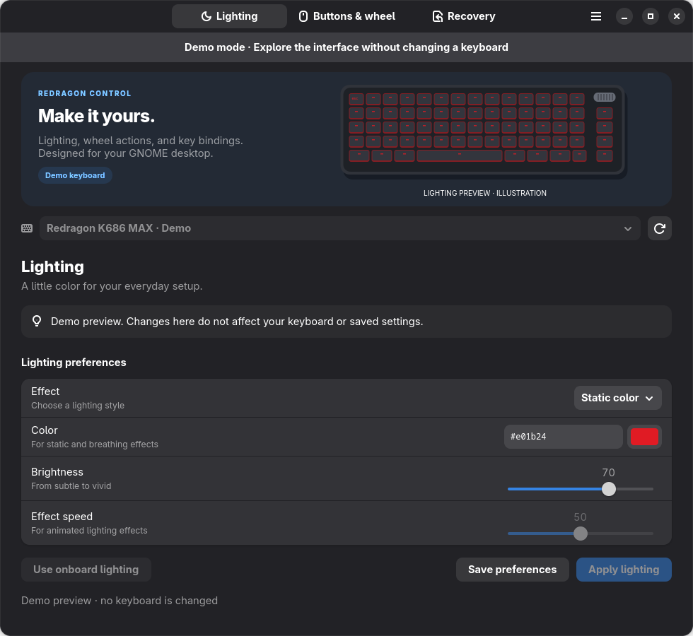
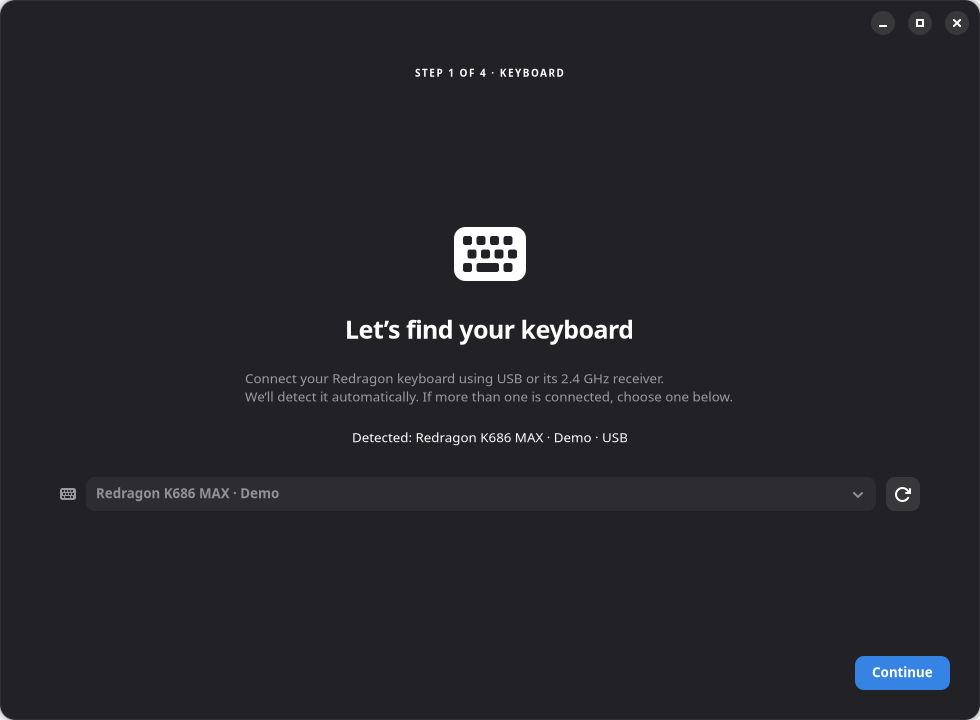
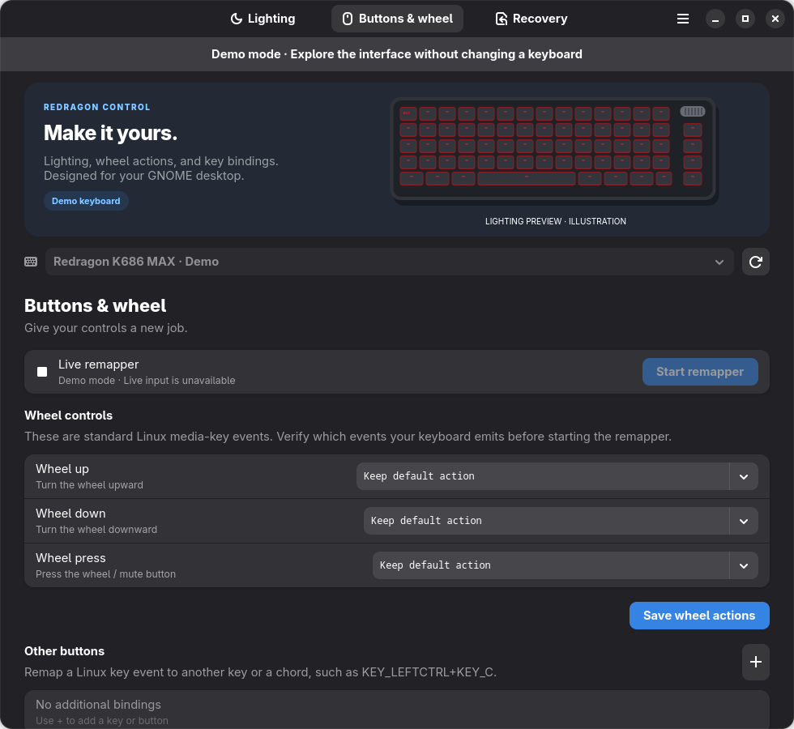

# Redragon Control

Make your keyboard feel like yours. Customize lighting, give the wheel new actions,
and save your favorite setups in a Linux desktop app built for the
**Redragon K686WBG-RGB-MAX**.

[Download from GitHub Releases](https://github.com/wfoyt/Redragon-Control/releases)
· [Installation](#install-the-flatpak)
· [Getting started](#getting-started)
· [Advanced guide](docs/advanced.md)



*App screenshots show demo mode, so you can explore the interface without changing a keyboard.*

## What you can do

- **Choose your lighting.** Pick a static color, adjust brightness, or turn the lights off.
- **Enjoy built-in animations.** Use 17 effects over the 2.4 GHz receiver, including
  Rainbow, Smooth breathing, Raindrops, and reactive effects that respond to typing.
- **Customize the wheel and keys.** Assign media controls, scrolling, keys, or keyboard
  shortcuts to the wheel, wheel press, and other keys.
- **Save your setups.** Create named profiles and import or export your lighting
  preferences and key bindings.
- **Keep your settings active.** Run in the background and resume enabled lighting
  and remapping after signing in.
- **Find your way back.** Restore onboard lighting, reset app settings, or follow
  the keyboard factory-reset guidance.

## Install the Flatpak

**Download the app from [GitHub Releases](https://github.com/wfoyt/Redragon-Control/releases).
Redragon Control is not available on Flathub.**

You need a Linux desktop, Flatpak, and an **x86_64 (64-bit Intel or AMD)** computer.
The app works with GNOME and KDE desktops that support background permissions.
It does not run on Windows or macOS.

1. Install Flatpak through your distribution’s Software app or package manager
   if you do not already have it.
2. Open [GitHub Releases](https://github.com/wfoyt/Redragon-Control/releases) and
   download the `.flatpak` file under **Assets**. For version 0.2.0, it is
   `Redragon-Control-0.2.0-x86_64.flatpak`.
3. Double-click the downloaded file and choose **Install** in your Software app.
   If your desktop does not open Flatpak files, use the terminal steps below.
4. Launch **Redragon Control** from your app launcher.

### Install from Terminal

Open a terminal in the folder containing your download and run:

```bash
flatpak remote-add --user --if-not-exists flathub https://flathub.org/repo/flathub.flatpakrepo
flatpak install --user ./Redragon-Control-0.2.0-x86_64.flatpak
flatpak run io.github.redragon.Control
```

Replace the filename if you downloaded a newer version. The Flathub command adds
access to the shared GNOME runtime the app needs; **the app itself is installed
from your GitHub download**. An internet connection is needed to download the
runtime if it is not already installed.

To update the app, download and install the newer `.flatpak` from GitHub Releases
using the same steps. `flatpak update` updates the shared runtime; it does not
fetch new Redragon Control releases.

## Getting started

1. **Connect your keyboard.** Use the USB cable, or plug in the receiver and switch
   the keyboard to **2.4G**. For wired use, set the keyboard’s mode switch to **OFF**.
2. **Allow keyboard access.** If prompted, choose **Save hardware setup script…**,
   save it, and run the exact `sudo bash …` command shown in the app in your normal
   desktop terminal. This one-time step lets Linux grant access to your keyboard.
   Reconnect it, then choose **Check again**.
3. **Allow background activity and automatic startup** when your desktop asks.
   Both permissions are needed to finish Flatpak startup setup.
4. **Follow the setup screens.** Select your keyboard, choose lighting and wheel
   actions, then open Redragon Control. You can also import an existing profile.
   Use **Apply** to activate changes during setup; **Next** continues without
   applying unsaved edits.



In the main window, use **Lighting** to choose an effect and select **Apply lighting**.
Under **Buttons & wheel**, save your wheel actions and select **Start remapper**.
Keep the knob in volume mode when remapping its volume controls.
Use the app menu to save, load, import, or export profiles.



Closing Settings leaves background services running. Use the tray menu to pause
lighting or remapping, or choose **Quit and stop keyboard services** to stop them
for the current session. On GNOME, an AppIndicator extension is needed to show
the tray icon; background services can still run without it.

## Supported keyboards and connections

This app supports the **Redragon K686WBG-RGB-MAX**. Other Redragon models are not
currently supported.

| Feature | USB cable | 2.4 GHz receiver | Bluetooth |
| --- | --- | --- | --- |
| Static color, brightness, and lights off | Yes | Yes | Not supported |
| Built-in lighting animations | Not supported | Yes — 17 effects | Not supported |
| Wheel and key remapping | Yes | Yes | Depends on Linux input access |

Key bindings work while the remapper is running on your computer; they are not
saved to the keyboard. Some **Fn** combinations are handled by the keyboard
itself and cannot be remapped. The lighting preview illustrates effects; actual
keyboard colors and timing may differ.

## Need help?

- **Keyboard not detected?** Check the connection and mode switch, reconnect it,
  and retry detection. If access is missing, follow the hardware setup prompt.
- **Animations unavailable?** Select the receiver and use **2.4G** mode.
  Wired USB supports static color and lights off.
- **Want the keyboard’s original lighting?** Choose **Use onboard lighting**.
- **Want to reset your changes?** Open **Recovery → Reset app settings**.
  Saved named profiles are kept. Export a profile first if you want a backup.
- **Need a keyboard factory reset?** Stop the app’s services, then hold
  **Fn + Esc for 3 seconds**. The Recovery page also provides guidance.

For source installation, command-line controls, Flatpak builds, troubleshooting,
and development details, see the [advanced guide](docs/advanced.md).
Hardware protocol details are in [protocol notes](docs/protocol.md).

Independent software, not affiliated with Redragon.
