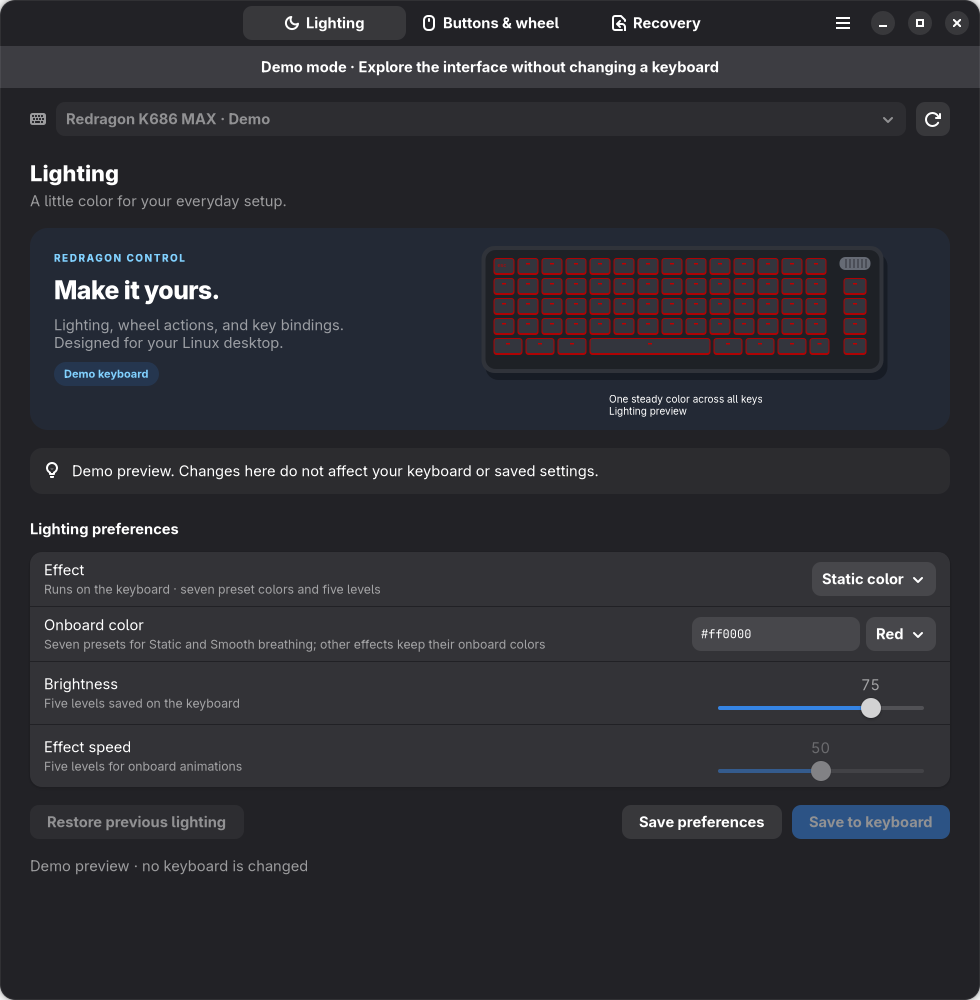

# Redragon Control: advanced guide

[← Back to the README](../README.md)

A native **GTK 4 / libadwaita** application and JSON CLI for Linux desktops,
built for the **Redragon K686WBG-RGB-MAX**. No web view or Electron runtime.



## AppImage installation and builds

Download the x86_64 AppImage, make it executable, and run it:

```bash
chmod +x Redragon-Control-0.2.6-x86_64.AppImage
./Redragon-Control-0.2.6-x86_64.AppImage
```

The app bundles Python, GTK, libadwaita, evdev and tray libraries. Flatpak
releases are no longer produced. **Enable keyboard access** on the first setup
page installs device-specific permissions through Polkit without running the
main application as root. Reconnect the receiver if permissions remain blocked.

See [AppImage build, migration and validation notes](appimage.md) for the
standalone build recipe, distribution requirements and old-profile migration.
An explicit `gui` launch also uses the tray to preserve the AppImage mount.
Use `--demo gui` to preview without starting services or writing settings.

## First launch

Redragon Control opens a four-page setup: keyboard detection, lighting,
wheel and key remapping, then a welcome page. A single supported connected
keyboard is selected automatically; multiple keyboards require a choice.
Detection retries while you connect your keyboard.

The first page also offers **Import a profile**. A successful import restores
saved lighting preferences and key bindings, then goes directly to Welcome.
Importing saves preferences without applying them to hardware; you can apply
them from the main app. Invalid profiles leave you on the first page.

Lighting and remapping both have separate **Apply** and **Next** buttons.
Apply saves and activates the chosen settings while keeping you on the page.
Applying remapping saves wheel and additional key bindings together and starts
remapping when there are custom actions. Next continues without applying,
discarding any edits made since the last Apply. You can change these settings
later in the main app. Next on lighting keeps your current onboard effect
unless you already applied app lighting.

Setup is marked complete when you select **Open Redragon Control** on the
welcome page. Closing earlier starts setup again on the next launch. Completion
is stored separately from portable profiles, so importing a profile does not
skip setup. New installations leave background services off until requested.
Demo mode also previews the full setup without saving completion or changing
hardware. The existing **Reset app settings** command retains named profiles
and keyboard selection; it is separate from a complete removal of user data.

## Current hardware support

| Feature | Support |
| --- | --- |
| Saved static color, brightness, off | 2.4 GHz only; seven presets and five brightness levels |
| Built-in animations | 17 native effects over 2.4 GHz; five brightness/speed levels |
| Smooth breathing | Retained native effect with seven preset colors |
| Wheel, wheel press, other keys | Linux input remapping over USB or 2.4 GHz; Bluetooth depends on input access |
| Key chords, media keys, horizontal/vertical scrolling | Supported by the remapping service on Linux Wayland and X11 desktops |
| Profiles and agent CLI | Implemented; versioned JSON settings and structured results |
| Restore app defaults | Stops both services and clears local lighting preferences and bindings |
| Keyboard factory reset | Guided physical reset: **hold Fn + Esc for 3 seconds** |
| Bluetooth RGB / on-device remapping / USB factory reset | Protocols not verified; not implemented |

The former wired and 2.4 GHz direct RGB paths were physically verified on this exact MAX keyboard:
the user confirmed steady teal in both connection modes, with the cable
disconnected for the wireless test. Both connections reported firmware model
**0x20**. The input remapping service successfully grabbed this keyboard's
real event nodes in both modes. The app checks the firmware model before
sending lighting commands.
The wireless receiver currently identifies as `3554:fa09`; wired mode should
identify as `258a:010c`. These are shared chipset IDs, so the app also checks
the HID report descriptor and firmware model before saving lighting. The receiver
must additionally report the exact K686 MAX product signature.
See [protocol provenance](protocol.md).

## Omarchy appearance and source installation

On Omarchy, **Automatic** follows the current desktop palette. On other
distributions it uses the existing Adwaita appearance. Open **Menu → Appearance**
to choose **Automatic**, **Adwaita**, or **Omarchy** explicitly. Changes apply
immediately and persist in `config.appearance.json`, separate from keyboard
profiles. Importing a profile does not change the app theme.

Omarchy mode reads the current `colors.toml` under
`$XDG_STATE_HOME/omarchy/current/theme/` (normally `~/.local/state/omarchy/`),
with support for the older config-directory layout. Theme file replacement is
watched, so a desktop theme change updates an open window. Missing/invalid
palettes fall back to Tokyo Night colors. System high contrast takes priority.
No Omarchy system files, shell plugins or hooks need to be modified.

For a native source installation on Omarchy/Arch, install the GTK, Python and
AppIndicator dependencies using the distribution's package manager:

```bash
omarchy pkg add python-gobject python-cairo gtk4 libadwaita python-evdev libayatana-appindicator
./run.sh gui
```

Use the one-time hardware setup below if access is missing. The AppImage bundles
these application dependencies instead.

## Run on Fedora

The GUI requires libadwaita 1.5 or newer, GTK 4.12 or newer, Python 3.11 or newer,
PyGObject, and Cairo bindings. The remapper additionally requires python-evdev.

```bash
sudo dnf install python3-gobject python3-cairo gtk4 libadwaita python3-evdev
./run.sh gui
```

Explore without changing hardware or stored settings:

```bash
./run.sh --demo gui
```

The project's `.venv`, when present, takes precedence and can use system GTK
bindings. For another Linux distribution, install its matching GTK/libadwaita,
PyGObject, Cairo and evdev packages. Alternatively use a virtual environment
created with `python3 -m venv --system-site-packages .venv`, then install evdev
there. Building evdev from source also requires Python development headers.

### One-time hardware access

Run the supplied setup once, then reconnect the keyboard:

```bash
sudo ./scripts/setup-hardware.sh
./run.sh doctor
```

This installs device-scoped udev rules for the IDs above, grants the active
local desktop user input/hidraw access, and enables `/dev/uinput` for virtual
input. It does not add you to the broad `input` group or make devices writable
by everyone. Active desktop applications share your user permissions, including
virtual input. Run the app and CLI as your normal user.

To undo system setup, stop the services, remove
`/etc/udev/rules.d/70-redragon-control.rules` and
`/etc/modules-load.d/redragon-control.conf`, reload udev rules, and reconnect.

### Desktop launcher

```bash
./scripts/install-user.sh
```

This adds Redragon Control to your desktop's app launcher and installs `~/.local/bin/redragonctl`.
Keep this source directory in place; the launcher points to `run.sh` here.

### Start in the system tray at login

The source installer and first normal app launch enable a login autostart entry in
`~/.config/autostart/io.github.redragon.Control.desktop`. It runs
the installed launcher with `tray`, which creates an AppIndicator. Until first-run setup is
complete, it also opens the setup window; subsequent logins stay in the tray.
GNOME and KDE Plasma use the standard XDG autostart entry. Omarchy also gets
`~/.config/omarchy/hooks/post-boot.d/redragon-control`, which runs after the desktop
starts and checks the same enabled preference. No Hyprland config edits are needed.
The tray uses a unique application ID, so overlapping startup requests share one
instance. AppImages register their permanent file, never the temporary mount;
launching a moved image updates its path. Keep the image in a stable location.
Demo mode and custom `--config` launches do not automatically register startup.

On GNOME, an AppIndicator extension is needed to display the tray icon;
startup and remapping still work without the extension. The indicator uses GTK3 and
AppIndicator in its own process; settings continue to use GTK4/libadwaita.
Fedora's indicator dependency is `libappindicator-gtk3` (already available on
the development machine); AyatanaAppIndicator3 is also supported.

The tray restores enabled remapping on login. Its menu offers **Open settings**,
a remapping toggle, and **Quit and stop keyboard services**. Closing the settings window
leaves the tray and mappings active. Disabled services stay disabled, including
when stopped from the CLI or the settings window. Enabled services are retried
after reconnecting the selected keyboard or a startup permission delay.

Quit stops services for this session while preserving their next-login state.
Use the menu toggles to persistently pause a service. Background preferences
are stored beside settings in `config.background.json`, separate from profiles.
Old RGB background preferences are disabled and old lighting workers are stopped;
lighting is never reapplied on a timer or at login.
Use **Launch at login** in the tray menu, or `redragonctl autostart disable`,
to disable startup on all three desktops. Use `redragonctl autostart enable` to
restore it, and `redragonctl autostart status` to inspect it. AppImage users can
pass the same `autostart` commands to their image. You can also remove the desktop
file or disable it in your desktop's startup-app settings; normal launches preserve
that choice. The Omarchy hook respects a missing or disabled desktop entry. Launch manually with
`./run.sh tray`. This runs after signing into your desktop, not before the login screen.

## First use

1. Follow the setup screen to detect your keyboard. The generic **CX 2.4G Wireless
   Receiver** is the current wireless connection. Setup lists known K686
   connections; the main app and CLI also list other HID devices for inspection.
2. For lighting, use the receiver with the keyboard in **2.4G** mode. Select
   that connection, choose your lighting, then **Save to keyboard**.
3. For the wheel, keep the knob in volume mode. Defaults emit `KEY_VOLUMEUP`,
   `KEY_VOLUMEDOWN`, and `KEY_MUTE`. Save new bindings and start the remapper.
4. Use `observe` to identify other buttons. Fn combinations consumed internally
   by the keyboard cannot be remapped unless they emit a Linux input event.

All animations now run on the keyboard itself through the 2.4 GHz receiver.
The Effect selector contains Smooth breathing plus Redragon's Rainbow,
Flash Away, Raindrops, Rainbow Wheel, Ripple Shining, Stars Twinkle,
Shadow Disappear, Retro Snake, Neon Stream, Reaction, Sine Wave,
Retinue Scanning, Rotating Windmill, Colorful Waterfall, Blossoming, and
Rotating Storm. Reactive effects need typing to show their animation.
The former software Breathing effect has been removed and Rainbow now selects
the keyboard's native moving rainbow. No animation frames are streamed.

Static color and Off now use saved onboard settings through the receiver.
Static and Smooth breathing use the seven native preset colors. Arbitrary
host RGB streaming has been removed, including its 20 Hz wireless refresh
(nine reports per static frame). No lighting service remains active after a save.
Closing or quitting the app leaves applied lighting on the keyboard.

Choose **Smooth breathing** for a smooth fade generated by the wireless
keyboard itself. Its preset selector offers red, green, blue, yellow, magenta,
cyan, and white; brightness and speed use 25-point steps. The preview animates
with those settings (it illustrates the effect rather than synchronizing with
the keyboard's phase). The other built-in effects preserve their onboard
colors and variants. All native effects use brightness/speed steps of 25.
The keyboard preview now draws colors per key, with distinct waves, rotating
patterns, trails, drops and twinkles for each selection. Reactive previews
replay simulated key presses, identified below the keyboard. These are
illustrations: onboard color variants, direction and timing may differ, and
the preview is not synchronized with live keyboard input or firmware frames.
Old custom Static colors and software Breathing profiles migrate to the nearest
preset color. Old brightness/speed values are rounded to supported 25-point steps.

All persistent lighting writes over USB remain unverified, so lighting controls
are disabled when the wired connection is selected. Use the receiver to save
lighting. Wired key/wheel remapping still works. There is no host streaming fallback.

Built-in effects change saved onboard lighting settings. Before the first
write, the app saves the complete original configuration in
`config.native-lighting-backup.json`, checks receiver acknowledgments, and
verifies the result by reading it back. A completed transaction is marked
committed; closing the HID descriptor never restores or rewrites it.
**Restore previous lighting**, or `rgb --restore`, explicitly restores and
verifies the original configuration, then removes the backup. Failed writes
attempt rollback; interrupted transactions retain the backup and recover before
the next explicit lighting apply. Unchanged hardware settings do not cause
another save. Changes preserve the keyboard's current unrelated settings.
No palette, keymap, reset or firmware commands are sent.

Remapping is applied by an unprivileged input service, not stored in firmware.
It runs after closing the GUI until stopped, you sign out, the machine restarts,
or the device disconnects. Tray mode restores enabled services on login and
retries after reconnects. Live profile changes are reloaded automatically.
The service restores original input by releasing grabs on exit. Reconnect and
restart it after an unplug when running without the tray; it does not select a
different, unlinked device automatically.
Your selection is tied to the USB port/physical input family to avoid grabbing
another keyboard. Link the keyboard's verified cable and receiver connections
with `link` to let the tray restore enabled services when you switch between
them. If both are connected, the selected connection takes priority. Links
live in `config.connections.json`; profiles do not change them. Select or
link again if you move a connection to another USB port.

Only interfaces exposing a changed binding are grabbed. Wheel-only remapping
leaves a separate typing interface on its native input path. Binding changes
preserve held keys and modifiers until release, and input-overflow recovery
reconstructs unbound held keys without firing mapped shortcuts.

## CLI for users and AI agents

Every normal command prints `{ "ok": true, "result": ... }` as JSON. Failures
print `{ "ok": false, "error": ... }` on stderr and exit 1. `observe` streams
one JSON event per line. No GUI or desktop session is needed to inspect settings.
Use `--config /absolute/path/config.json` **before** the subcommand to isolate
an agent's settings from your usual configuration.

```bash
./run.sh devices
./run.sh select 3554:fa09
./run.sh observe --timeout 15 --limit 30
./run.sh bind KEY_VOLUMEUP scroll-up
./run.sh bind KEY_VOLUMEDOWN scroll-down
./run.sh bind KEY_MUTE KEY_PLAYPAUSE
./run.sh bind KEY_F12 KEY_LEFTCTRL+KEY_LEFTALT+KEY_T
./run.sh daemon start
./run.sh status
./run.sh unbind KEY_F12
./run.sh daemon stop --kind all

# Link the wired/receiver endpoints for input remapping
./run.sh select 258a:010c
# With the receiver connected, link it to the selected wired keyboard:
./run.sh link 3554:fa09
# Select the receiver in 2.4G mode for all lighting saves
./run.sh select 3554:fa09
./run.sh rgb --mode static --color '#00ffff' --brightness 75 --apply
./run.sh rgb --mode rainbow --brightness 75 --speed 50 --apply
./run.sh rgb --mode reaction --brightness 75 --speed 50 --apply
# Smooth wireless breathing (preset colors; levels 0, 25, 50, 75, 100)
./run.sh rgb --mode smooth-breathing --color '#00ffff' --brightness 75 --speed 50 --apply
./run.sh rgb --mode off --apply
./run.sh rgb --restore
./run.sh theme auto
./run.sh theme adwaita
./run.sh theme omarchy

./run.sh profile save Work
./run.sh profile export /tmp/redragon-profile.json
./run.sh profile import /tmp/redragon-profile.json
./run.sh profile load Work
./run.sh reset app --yes
./run.sh reset factory
```

When two devices have the same VID:PID, select their full ID from `devices`
(for example `3554:fa09@de64c78abcfb`); an ambiguous short ID is rejected.
Profile import validates every setting and preserves your currently selected
keyboard. It saves lighting preferences without writing hardware. Apply lighting
explicitly after importing; active remapping still reloads saved bindings.
Bindings accept Linux `KEY_*` names, `+`-joined key chords, `scroll-up`,
`scroll-down`, `scroll-left`, `scroll-right`, `disabled`, or `default`.
Wheel sources can also be `REL_WHEEL_UP`, `REL_WHEEL_DOWN`,
`REL_HWHEEL_LEFT`, and `REL_HWHEEL_RIGHT` when the hardware emits mouse-wheel
events rather than volume keys.

Settings and profiles live in `~/.config/redragon-control/` (or
`$XDG_CONFIG_HOME/redragon-control/`). Writes are locked and atomically replaced.
Service logs and process metadata live beside the selected configuration file.
No telemetry, network service, arbitrary shell command execution, or firmware
flashing is included.

## Recovery

Use **Recovery → Reset app settings** or `./run.sh reset app --yes` to stop
both background services, clear local bindings, and reset lighting preferences.
Named profiles are retained. Applied onboard lighting is retained; use
**Restore previous lighting** or `rgb --restore` to undo it. Stopping input
remapping restores original button events.

For the keyboard's actual factory settings, stop the services and hold
**Fn + Esc for 3 seconds**, as documented in
[Redragon's official manual](https://cdn.shopify.com/s/files/1/0012/4957/4961/files/K686_user_manual.pdf?v=1723515517).
The app includes a factory-reset guidance button. Fn is handled inside the
keyboard; there is no verified USB reset command in this implementation.

If input is ever unusable, unplug and reconnect the keyboard; input grabs are
released when a device disappears. The remapper never modifies firmware.

## Validation

```bash
./run.sh --help
.venv/bin/python -m unittest discover -s tests -v
```

The automated suite exercises appearance detection and persistence, palette
validation, one-shot lighting saves, firmware-model rejection,
device identity, event routing, chord releases, high-resolution wheel handling,
service cleanup, configuration validation, profile isolation, and JSON CLI
results, all native effect IDs/parameter positions, preservation of other
settings, wireless packet framing, paired-model rejection, and explicit
connection switching. Native UI pages and bright/dim breathing frames have
been rendered and visually checked; GTK frame-clock animation was verified.
Historical wired and wireless model probing, direct static RGB, and
input-service startup were verified before host streaming was removed. The user confirmed smooth native
cyan breathing, the native moving Rainbow, and wireless wheel-press remapping.
All 17 native animation selections passed actual receiver read-back. Native effect read-back,
byte-for-byte stop recovery, restart, and idle operation without continuous
RGB writes were verified on hardware. The new static-preset/Off encodings and
save-on-close behavior have automated coverage; they have not been physically
retested in this development session. Event transformation edge cases,
recovery failure paths, and effect generation are covered by automated tests.
